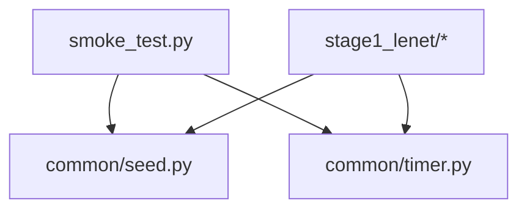

# Stage 0：环境与项目骨架

本阶段完成运行环境的搭建，并提供后续所有阶段共用的两个工具：随机种子控制和基准计时。

## 1. 环境事实

| 项目 | 值 |
|------|-----|
| 操作系统 | Linux |
| Python | 3.11.2 |
| CPU | 2 核 |
| 内存 | 约 7.8 GB（可用约 6 GB） |
| GPU | 无 |
| PyTorch | 2.14.0+cpu |
| torchvision | 0.29.0+cpu |

安装命令（CPU wheel，避免拉入 CUDA 依赖）：

```bash
pip install --break-system-packages --index-url https://download.pytorch.org/whl/cpu torch torchvision
pip install --break-system-packages numpy matplotlib pytest
```

说明：`--break-system-packages` 允许在系统 Python 环境中安装；`--index-url https://download.pytorch.org/whl/cpu` 指定 CPU 专用源，包体积明显更小。

## 2. requirements.txt 逐行说明

```
torch
torchvision
numpy
matplotlib
pytest
```

- `torch`：核心张量库与自动微分，全部实验的基础。
- `torchvision`：提供 MNIST 数据集与图像变换（Stage 1、Stage 2 使用）。
- `numpy`：数值工具，图像与统计辅助。
- `matplotlib`：可视化训练曲线（按需使用）。
- `pytest`：运行 `tests/` 下的正确性测试。

## 3. src/common/seed.py 逐行说明

代码位置：`src/common/seed.py`

```python
import random

import numpy as np
import torch

DEFAULT_SEED = 42


def set_seed(seed: int = DEFAULT_SEED) -> None:
    random.seed(seed)
    np.random.seed(seed)
    torch.manual_seed(seed)
    torch.cuda.manual_seed_all(seed)


def get_device() -> torch.device:
    return torch.device("cuda" if torch.cuda.is_available() else "cpu")
```

- L1 `import random`：导入 Python 标准库的随机模块，用于固定 `random` 的随机状态。
- L3 `import numpy as np`：导入 NumPy，用于固定 NumPy 的随机状态。
- L4 `import torch`：导入 PyTorch，用于固定其随机状态并检测设备。
- L6 `DEFAULT_SEED = 42`：全局默认种子。选 42 只是因为它是常见约定，任何固定整数都可，作用是可复现。
- L9 `def set_seed(seed: int = DEFAULT_SEED) -> None:`：定义统一入口，默认使用全局种子，返回 `None`。
- L10 `random.seed(seed)`：固定 Python 内置随机数生成器。数据增强中若用到 `random`，结果才可复现。
- L11 `np.random.seed(seed)`：固定 NumPy 全局随机数生成器。
- L12 `torch.manual_seed(seed)`：固定 PyTorch CPU 及默认 CUDA 的随机数生成器，控制权重初始化和 `torch.randn` 的结果。
- L13 `torch.cuda.manual_seed_all(seed)`：固定所有 CUDA 设备的随机状态。当前环境无 GPU，这一行不会生效，保留是为了在迁移到 GPU 时行为一致。
- L16 `def get_device() -> torch.device:`：返回本机可用于计算的设备对象。
- L17 `return torch.device("cuda" if torch.cuda.is_available() else "cpu")`：有 GPU 用 `cuda`，否则用 `cpu`。当前环境恒为 `cpu`。写成函数而非硬编码，使代码在 GPU 机器上无需修改即可运行。

可复现性在编译器实验中的意义：Stage 4 的融合 pass 要求「优化前」与「优化后」输出数值一致，如果权重初始化每次都不同，就无法区分误差来自哪一方。

## 4. src/common/timer.py 逐行说明

代码位置：`src/common/timer.py`

```python
import statistics
import time
from dataclasses import dataclass
from typing import Callable

import torch


@dataclass
class BenchResult:
    median_ms: float
    min_ms: float
    max_ms: float
    samples_ms: list[float]

    def __str__(self) -> str:
        return (
            f"median={self.median_ms:.3f}ms "
            f"min={self.min_ms:.3f}ms max={self.max_ms:.3f}ms"
        )


def synchronize(device: torch.device) -> None:
    if device.type == "cuda":
        torch.cuda.synchronize(device)


def benchmark(
    fn: Callable[[], object],
    *,
    warmup: int = 3,
    iters: int = 10,
    device: torch.device | None = None,
) -> BenchResult:
    device = device or torch.device("cpu")
    with torch.no_grad():
        for _ in range(warmup):
            fn()
        synchronize(device)
        samples: list[float] = []
        for _ in range(iters):
            start = time.perf_counter()
            fn()
            synchronize(device)
            samples.append((time.perf_counter() - start) * 1000.0)
    return BenchResult(
        median_ms=statistics.median(samples),
        min_ms=min(samples),
        max_ms=max(samples),
        samples_ms=samples,
    )
```

- L1 `import statistics`：使用 `statistics.median` 计算中位数。
- L2 `import time`：使用 `time.perf_counter` 获取高精度计时。
- L3 `from dataclasses import dataclass`：用装饰器生成数据类，省去手写 `__init__`。
- L4 `from typing import Callable`：类型标注，表示「可调用对象」。
- L6 `import torch`：用于 `no_grad` 与 CUDA 同步。
- L9 `@dataclass`：自动生成 `__init__`、`__repr__` 等方法。
- L10 `class BenchResult:`：封装一次基准测试的结果。
- L11 `median_ms: float`：多次测量的中位数（毫秒）。中位数比平均值更能抵抗偶发抖动。
- L12 `min_ms: float`：最小值，代表最理想情况下的耗时。
- L13 `max_ms: float`：最大值，用于判断数据抖动幅度。
- L14 `samples_ms: list[float]`：保留全部原始样本，便于事后分析。
- L16-L20 `__str__`：把结果格式化为一行可读文本，统一保留三位小数。
- L23 `def synchronize(device: torch.device) -> None:`：确保设备上的异步任务完成。
- L24 `if device.type == "cuda":`：只有 CUDA 需要显式同步，CPU 上的算子天然同步。
- L25 `torch.cuda.synchronize(device)`：阻塞直到该 GPU 上的所有核函数执行完毕。
- L28-L34 `def benchmark(...)`：基准测试主函数。参数 `fn` 是待测函数；`*` 使后面三个参数只能按关键字传入，避免调用时位置参数混淆；`warmup` 预热次数；`iters` 正式测量次数；`device` 测量设备。
- L35 `device = device or torch.device("cpu")`：未传设备时默认 CPU。
- L36 `with torch.no_grad():`：关闭自动微分，避免基准测试时构建计算图，测的是纯前向开销。
- L37-L38 `for _ in range(warmup): fn()`：预热。首次调用会触发惰性初始化、内存分配、缓存建立，这些一次性开销不应计入结果。
- L39 `synchronize(device)`：预热后同步一次，确保计时起点干净。
- L40 `samples: list[float] = []`：收集每次测量值。
- L41-L45 测量循环：
  - L42 `start = time.perf_counter()`：记录起点，`perf_counter` 是最小分辨率最高的计时器。
  - L43 `fn()`：执行一次待测函数。
  - L44 `synchronize(device)`：等待异步工作完成，否则 GPU 上会测出接近 0 的假值。
  - L45 `samples.append((time.perf_counter() - start) * 1000.0)`：计算耗时并换算成毫秒。
- L46-L51 `return BenchResult(...)`：把中位数、最小值、最大值与原始样本打包返回。

为什么必须取中位数：这台机器有 2 个 CPU 核，训练与测量会争抢算力，单次测量波动可能达到数倍。Stage 4 要比较融合前后的延迟，采用「预热 + 多次取中位数」才能得到可信的结论。

## 5. src/smoke_test.py 逐行说明

代码位置：`src/smoke_test.py`。作用是确认环境可用：前向能跑通、反向能产生非零梯度、计时器可用。

```python
import torch
from torch import nn

from src.common.seed import get_device, set_seed
from src.common.timer import benchmark


class MLP(nn.Module):
    def __init__(self, in_features: int = 784, hidden: int = 128, out_features: int = 10):
        super().__init__()
        self.net = nn.Sequential(
            nn.Linear(in_features, hidden),
            nn.ReLU(),
            nn.Linear(hidden, out_features),
        )

    def forward(self, x: torch.Tensor) -> torch.Tensor:
        return self.net(x)


def main() -> None:
    set_seed()
    device = get_device()
    print(f"torch={torch.__version__} device={device}")

    model = MLP().to(device)
    x = torch.randn(32, 784, device=device)
    logits = model(x)
    assert logits.shape == (32, 10), logits.shape
    print(f"forward ok: input {tuple(x.shape)} -> logits {tuple(logits.shape)}")

    loss = nn.functional.cross_entropy(logits, torch.randint(0, 10, (32,), device=device))
    loss.backward()
    grad_norm = model.net[0].weight.grad.norm().item()
    assert grad_norm > 0
    print(f"backward ok: first linear grad norm = {grad_norm:.4f}")

    result = benchmark(lambda: model(x), device=device)
    print(f"benchmark ok: {result}")


if __name__ == "__main__":
    main()
```

- L1 `import torch`：导入 PyTorch。
- L2 `from torch import nn`：导入神经网络模块，取别名 `nn`。
- L4-L5：从本项目公共模块导入种子与计时工具，验证跨文件导入路径（`src.`）配置正确。
- L8 `class MLP(nn.Module):`：定义一个最小的多层感知机，用来做冒烟测试。
- L9 `def __init__(self, ...)`：构造函数。`in_features=784` 对应 28x28 展平后的维度；`hidden=128` 是隐藏层宽度；`out_features=10` 对应 10 个类别。
- L10 `super().__init__()`：初始化父类 `nn.Module`，这是注册子模块与参数的前提。
- L11-L15 `self.net = nn.Sequential(...)`：按顺序组装两层线性层与一个 ReLU。`Sequential` 会自动按顺序调用各层。
- L17-L18 `forward`：定义前向计算，直接调用 `self.net(x)`。
- L21 `def main() -> None:`：主流程入口。
- L22 `set_seed()`：固定随机状态，让每次运行结果一致。
- L23 `device = get_device()`：获取计算设备。
- L24 `print(...)`：打印 PyTorch 版本与设备，便于确认环境。
- L26 `model = MLP().to(device)`：实例化模型并迁移到目标设备。
- L27 `x = torch.randn(32, 784, device=device)`：构造一个 batch 为 32 的随机输入。
- L28 `logits = model(x)`：执行前向传播。
- L29 `assert logits.shape == (32, 10), logits.shape`：断言输出形状正确。若形状错误，断言消息会打印实际形状。
- L30 `print(...)`：输出前向结果。
- L32 `loss = nn.functional.cross_entropy(logits, torch.randint(0, 10, (32,), device=device))`：用随机标签计算交叉熵。这一步只是为了给反向传播一个起点，标签是否正确无关紧要。
- L33 `loss.backward()`：触发反向传播，填充各参数的 `.grad`。
- L34 `grad_norm = model.net[0].weight.grad.norm().item()`：取第一层线性权重的梯度 L2 范数。`net[0]` 是第一个 `nn.Linear`；`.item()` 把单元素张量转为 Python 浮点数。
- L35 `assert grad_norm > 0`：梯度必须非零，否则说明反向链路断了。
- L36 `print(...)`：输出梯度范数。
- L38 `result = benchmark(lambda: model(x), device=device)`：用公共计时器测量前向一次。`lambda: model(x)` 把带参数的调用包装成无参可调用对象。
- L39 `print(...)`：输出计时结果。
- L42-L43 `if __name__ == "__main__": main()`：只有直接运行该文件时才执行 `main`，被 import 时不执行。

## 6. 验收与运行方式

运行冒烟测试：

```bash
python3 -m src.smoke_test
```

实际输出：

```
torch=2.14.0+cpu device=cpu
forward ok: input (32, 784) -> logits (32, 10)
backward ok: first linear grad norm = 1.9108
benchmark ok: median=0.060ms min=0.054ms max=0.063ms
```

三项验收全部通过：前向形状 `(32,784) -> (32,10)` 正确；反向得到非零梯度 `1.9108`；计时器正常返回中位数。

## 7. 模块依赖关系



公共模块 `seed.py` 与 `timer.py` 被后续所有阶段复用，这是把它们放在 `src/common/` 的原因。
