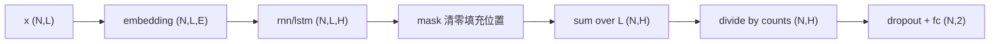

# Stage 2：RNN 与 LSTM 情感分类对比

本阶段在 IMDB 子集上实现一个情感分类器，循环单元可在 `nn.RNN` 与 `nn.LSTM` 之间切换，其余结构完全一致，用于量化对比两者的准确率与计算开销。

## 1. 验收标准

| 项目 | 标准 | 实际结果 |
|------|------|----------|
| RNN 收敛 | final_acc > 75% | 82.86% |
| LSTM 收敛 | final_acc > 75% | 82.74% |
| 单元测试 | 通过 | 4 passed（含 Stage 1） |

## 2. 数据管线 src/stage2_rnn/data.py 逐行说明

代码位置：`src/stage2_rnn/data.py`

不依赖 `torchtext`，只用标准库下载解压原版 IMDB tar 包，避免 torchtext 版本与 PyTorch 不匹配的问题。

### 2.1 导入与常量（L1-L25）

- L1-L4 文档字符串：说明管线职责与不依赖 torchtext 的原因。
- L6 `import re`：正则表达式，用于去 HTML 标签与分词。
- L7 `import tarfile`：解压 `.tar.gz`。
- L8 `import urllib.request`：下载数据集。
- L9 `from collections import Counter`：统计词频。
- L10 `from pathlib import Path`：路径操作。
- L12 `import torch`：构造张量。
- L13 `from torch.utils.data import DataLoader, Dataset`：数据集与加载器基类。
- L15 `ROOT = Path(__file__).resolve().parents[2]`：仓库根目录。
- L16 `ARTIFACTS = ROOT / "artifacts"`：产物目录。
- L17 `DATA_DIR = ARTIFACTS / "data"`：数据缓存目录，与 MNIST 共用。
- L18 `URL = "..."`：IMDB 原始数据集地址，来自斯坦福。
- L19 `ARCHIVE = DATA_DIR / "aclImdb_v1.tar.gz"`：压缩包本地路径。
- L20 `EXTRACTED = DATA_DIR / "aclImdb"`：解压后的目录。用它的存在性判断是否需要重新下载。
- L22 `PAD, UNK = "<pad>", "<unk>"`：两个特殊符号。`<pad>` 用于填充到定长，`<unk>` 代表词表外单词。
- L24 `_TAG_RE = re.compile(r"<[^>]+>")`：匹配 HTML 标签，例如 `<br />`。前导下划线表示模块内部使用。
- L25 `_TOKEN_RE = re.compile(r"[a-z0-9']+")`：匹配小写字母、数字、撇号组成的词元。先转小写，所以这里只写小写区间。

### 2.2 分词 tokenize（L28-L30）

- L28 `def tokenize(text: str) -> list[str]:`：把一段评论文本切成词元列表。
- L29 `text = _TAG_RE.sub(" ", text.lower())`：先全部转小写，再把 HTML 标签替换为一个空格。替换成空格而不是删除，避免相邻词粘连。
- L30 `return _TOKEN_RE.findall(text)`：找出所有词元。标点与空白自然被丢弃。

### 2.3 下载与解压 download_and_extract（L33-L42）

- L33 `def download_and_extract() -> Path:`：返回解压目录。
- L34 `DATA_DIR.mkdir(parents=True, exist_ok=True)`：确保目录存在。`parents=True` 会创建缺失的中间目录。
- L35 `if not EXTRACTED.exists():`：已解压过就跳过，实现幂等。
- L36-L38 `if not ARCHIVE.exists(): print(...); urllib.request.urlretrieve(URL, ARCHIVE)`：压缩包已下载就不重复下载。`urlretrieve` 把远程文件保存到本地路径。
- L39 `print(f"extracting {ARCHIVE}")`：提示解压开始。
- L40-L41 `with tarfile.open(ARCHIVE, "r:gz") as tf: tf.extractall(DATA_DIR)`：以 gzip 模式打开 tar 包并全部解压到数据目录。`with` 保证文件句柄关闭。
- L42 `return EXTRACTED`。

### 2.4 读取一个划分 read_split（L45-L53）

- L45 `def read_split(root: Path, split: str, per_class: int | None):`：`split` 取 `"train"` 或 `"test"`；`per_class` 限定每类读取多少条，`None` 表示全部。
- L46 `samples = []`：收集 `(文本, 标签)`。
- L47 `for label, sub in ((1, "pos"), (0, "neg")):`：正类标签 1，目录 `pos`；负类标签 0，目录 `neg`。
- L48 `files = sorted((root / split / sub).glob("*.txt"))`：列出该目录下所有 `.txt`。`sorted` 保证顺序确定，便于复现。
- L49-L50 `if per_class is not None: files = files[:per_class]`：取前若干条。这是「子集」的实现方式。
- L51-L52 `for path in files: samples.append((path.read_text(...), label))`：读取文本。`encoding="utf-8"` 与 `errors="ignore"` 保证遇到异常编码字符时不中断。
- L53 `return samples`。

### 2.5 构建词表 build_vocab（L56-L65）

- L56 `def build_vocab(samples, max_size=20000, min_freq=2)`：返回 `{词: 索引}`。
- L57 `counter = Counter()`：词频计数器。
- L58-L59 `for text, _ in samples: counter.update(tokenize(text))`：只统计训练集，避免测试集信息泄漏。
- L60 `vocab = {PAD: 0, UNK: 1}`：先固定两个特殊符号的索引。索引 0 用作 `padding_idx`。
- L61 `for token, freq in counter.most_common():`：按词频从高到低遍历。
- L62-L63 `if len(vocab) >= max_size or freq < min_freq: break`：词表满或词频不足即停止。由于按词频降序，后续词的词频只会更低，直接 `break` 即可。
- L64 `vocab[token] = len(vocab)`：当前词表大小就是新词的索引。
- L65 `return vocab`。

### 2.6 编码 encode（L68-L72）

- L68 `def encode(text, vocab, max_len)`：把文本变成定长索引序列。
- L69 `ids = [vocab.get(tok, vocab[UNK]) for tok in tokenize(text)]`：词表里查不到就用 `<unk>` 的索引。
- L70-L71 `if len(ids) < max_len: ids = ids + [vocab[PAD]] * (max_len - len(ids))`：不足则用 `<pad>` 补齐。
- L72 `return ids[:max_len]`：超长则截断。补与截组合保证序列长度恒为 `max_len`。

### 2.7 数据集 IMDBDataset（L75-L84）

- L75 `class IMDBDataset(Dataset):`：继承 `Dataset`，可被 `DataLoader` 使用。
- L76-L77 `__init__`：在构造时一次性把所有样本编码好，存到 `self.encoded`。编码只依赖词表，预先算好能避免每个 epoch 重复分词。
- L79-L80 `__len__`：返回样本数，`DataLoader` 用它决定 epoch 长度。
- L82-L84 `__getitem__`：返回 `(索引序列张量, 标签张量)`。`dtype=torch.long` 是 `Embedding` 与 `CrossEntropyLoss` 要求的整数类型。

### 2.8 组装 build_datasets / build_loaders（L87-L111）

- L87-L93 `build_datasets(...)`：默认 `train_per_class=2500`、`test_per_class=2500`、`max_len=200`、`max_vocab=20000`、`min_freq=2`。
- L94 `root = download_and_extract()`：确保数据就绪。
- L95-L96：读取训练与测试划分。
- L97 `vocab = build_vocab(train_samples, max_vocab, min_freq)`：只用训练集建词表。
- L98-L102：返回两个数据集与词表。
- L105 `def build_loaders(batch_size=64, **kwargs):`：`**kwargs` 透传给 `build_datasets`，便于命令行覆盖。
- L106 `train_ds, test_ds, vocab = build_datasets(**kwargs)`。
- L107-L111：返回加载器。训练集 `shuffle=True`，测试集 `shuffle=False`。

### 2.9 入口 main（L114-L125）

- L114-L121：构建数据集并打印词表大小、正负样本数、样例序列长度与前 12 个索引，用于确认管线正确。
- L124-L125：仅在直接运行时执行。

## 3. 模型 src/stage2_rnn/model.py 逐行说明

代码位置：`src/stage2_rnn/model.py`

```python
from torch import nn

CELL_TYPES = ("rnn", "lstm")


class SentimentClassifier(nn.Module):
    """Embedding + 循环层 + 掩码平均池化 + 线性分类头。

    cell_type 取 "rnn" 或 "lstm"，其余结构完全一致，用于公平对比两种循环单元。
    """

    def __init__(
        self,
        vocab_size: int,
        embed_dim: int = 64,
        hidden_dim: int = 64,
        num_layers: int = 1,
        cell_type: str = "rnn",
        num_classes: int = 2,
        dropout: float = 0.3,
        pad_idx: int = 0,
    ):
        super().__init__()
        if cell_type not in CELL_TYPES:
            raise ValueError(f"cell_type must be one of {CELL_TYPES}, got {cell_type}")
        self.cell_type = cell_type
        self.pad_idx = pad_idx
        self.embedding = nn.Embedding(vocab_size, embed_dim, padding_idx=pad_idx)
        rnn_cls = nn.RNN if cell_type == "rnn" else nn.LSTM
        self.rnn = rnn_cls(
            embed_dim,
            hidden_dim,
            num_layers=num_layers,
            batch_first=True,
            bidirectional=False,
        )
        self.dropout = nn.Dropout(dropout)
        self.fc = nn.Linear(hidden_dim, num_classes)

    def forward(self, x):
        mask = (x != self.pad_idx).unsqueeze(-1).to(x.dtype)
        emb = self.embedding(x)
        out, _ = self.rnn(emb)
        summed = (out * mask).sum(dim=1)
        counts = mask.sum(dim=1).clamp(min=1.0)
        pooled = summed / counts
        return self.fc(self.dropout(pooled))
```

- L1 `from torch import nn`：导入网络模块。
- L3 `CELL_TYPES = ("rnn", "lstm")`：合法单元类型元组，供校验与遍历使用。
- L6 `class SentimentClassifier(nn.Module):`：情感分类器。
- L12-L22 `__init__` 参数：
  - `vocab_size`：词表大小，决定 Embedding 的行数。
  - `embed_dim=64`：词向量维度。默认改为 128 由命令行覆盖。
  - `hidden_dim=64`：循环层隐藏状态维度。
  - `num_layers=1`：循环层堆叠层数。
  - `cell_type="rnn"`：选择循环单元。
  - `num_classes=2`：二分类。
  - `dropout=0.3`：丢弃率。
  - `pad_idx=0`：填充符号的索引，与词表约定一致。
- L23 `super().__init__()`：初始化父类。
- L24-L25 `if cell_type not in CELL_TYPES: raise ValueError(...)`：尽早拒绝非法取值，避免运行到后面才报错。
- L26 `self.cell_type = cell_type`：记录类型，后续做结果表格时使用。
- L27 `self.pad_idx = pad_idx`：记录填充索引，`forward` 里要用。
- L28 `self.embedding = nn.Embedding(vocab_size, embed_dim, padding_idx=pad_idx)`：词嵌入表，形状 `(vocab_size, embed_dim)`。`padding_idx` 使 `<pad>` 对应的向量在训练中不更新梯度。
- L29 `rnn_cls = nn.RNN if cell_type == "rnn" else nn.LSTM`：按类型选择类对象。把「选择哪个类」与「如何构造」分离，后面只需一份构造代码。
- L30-L36 `self.rnn = rnn_cls(...)`：构造循环层。`batch_first=True` 使输入输出以 batch 为第 0 维，与后续张量操作一致；`bidirectional=False` 保持两模型结构对称。
- L37 `self.dropout = nn.Dropout(dropout)`：丢弃层，缓解过拟合。
- L38 `self.fc = nn.Linear(hidden_dim, num_classes)`：分类头，把池化后的隐藏表示映射到 2 类 logits。
- L40 `def forward(self, x):`：`x` 形状 `(N, L)`，L 为定长序列长度。
- L41 `mask = (x != self.pad_idx).unsqueeze(-1).to(x.dtype)`：生成掩码。`x != pad_idx` 得到 `(N, L)` 的布尔张量；`unsqueeze(-1)` 变成 `(N, L, 1)` 以便与隐藏状态广播；`to(x.dtype)` 转成浮点以便相乘。
- L42 `emb = self.embedding(x)`：`(N, L) -> (N, L, E)`。
- L43 `out, _ = self.rnn(emb)`：循环层输出。`out` 形状 `(N, L, H)`，是每个时间步的隐藏状态；第二个返回值是末状态（RNN）或 `(h, c)`（LSTM），这里不用，统一用 `_` 接收。
- L44 `summed = (out * mask).sum(dim=1)`：把填充位置的输出清零后，在时间维求和。`(N, L, H) * (N, L, 1)` 广播得到 `(N, L, H)`，`sum(dim=1)` 得 `(N, H)`。
- L45 `counts = mask.sum(dim=1).clamp(min=1.0)`：每个样本的非填充步数。`clamp(min=1.0)` 防止空序列导致除零。
- L46 `pooled = summed / counts`：掩码平均池化。
- L47 `return self.fc(self.dropout(pooled))`：先 dropout 再分类，得到 `(N, 2)`。

### 为什么用掩码平均池化

定长填充会引入大量 `<pad>` 时间步。循环层在 `<pad>` 位置仍会推进隐藏状态，若直接对全部时间步求平均，填充长度会污染分类特征。掩码平均池化只对真实词元位置求平均，排除填充影响。



## 4. 训练与对比 src/stage2_rnn/train.py 逐行说明

代码位置：`src/stage2_rnn/train.py`

### 4.1 导入与路径（L1-L13）

- L1-L3 `argparse`、`time`、`Path`：命令行、计时、路径。
- L5-L6 `torch`、`nn`。
- L8-L10：项目公共工具、数据加载器、模型与合法单元类型。
- L12-L13：`ROOT` 与 `ARTIFACTS`。

### 4.2 评估 evaluate（L16-L27）

- L16 `@torch.no_grad()`：评估关闭梯度。
- L17-L27：与 Stage 1 的评估逻辑一致。`reduction="sum"` 累加损失，最后除以样本总数得到精确平均；`argmax(1)` 取预测类别。

### 4.3 训练单个模型 train_one（L30-L77）

- L30 `def train_one(cell_type, args, train_loader, test_loader, vocab_size, device, log):`：训练并返回该单元的指标。
- L31 `set_seed()`：每次训练前重置种子，保证 RNN 与 LSTM 从同样的初始化分布与数据顺序出发，对比才公平。
- L32-L40：构造 `SentimentClassifier` 并迁移设备。
- L41 `optimizer = torch.optim.Adam(model.parameters(), lr=args.lr)`：Adam 优化器。
- L42 `num_params = sum(p.numel() for p in model.parameters())`：统计参数量，用于对比两模型的容量差异。
- L44 `log(f"=== {cell_type.upper()} (params={num_params}) ===")`：标记当前训练对象。
- L45-L46 `epoch_times = []`、`final_acc = 0.0`：记录每个 epoch 耗时与最终准确率。
- L47 `for epoch in range(1, args.epochs + 1):`：epoch 循环。
- L48 `model.train()`：训练模式。
- L49-L51 `start = time.time()`、`running = 0.0`、`seen = 0`：计时与累计。
- L52-L61 batch 循环：
  - L53 `x, y = x.to(device), y.to(device)`：迁移数据。
  - L54 `optimizer.zero_grad()`：清空历史梯度。
  - L55 `logits = model(x)`：前向。
  - L56 `loss = nn.functional.cross_entropy(logits, y)`：交叉熵。
  - L57 `loss.backward()`：反向。
  - L58 `nn.utils.clip_grad_norm_(model.parameters(), max_norm=5.0)`：梯度裁剪。循环网络在长序列上容易出现梯度爆炸，把梯度总范数限制在 5 以内可稳定训练。`clip_grad_norm_` 带下划线表示原地修改。
  - L59 `optimizer.step()`：更新参数。
  - L60-L61：累计损失与样本数。
- L62-L63 `dt = time.time() - start`、`epoch_times.append(dt)`：记录该 epoch 耗时。
- L64 `final_acc, test_loss = evaluate(model, test_loader, device)`：评估。
- L65-L68 `log(...)`：打印该 epoch 指标。
- L70 `torch.save(model.state_dict(), ARTIFACTS / f"stage2_{cell_type}.pt")`：按单元类型分别保存权重。
- L71-L77：返回结构化指标，`mean_epoch_s` 为平均每 epoch 耗时，`total_s` 为总耗时。

### 4.4 主流程 main（L80-L141）

- L81-L93：命令行参数。默认 `epochs=5`、`batch_size=64`、`lr=1e-3`、`embed_dim=128`、`hidden_dim=128`、`num_layers=1`、`dropout=0.3`、`train_per_class=5000`、`test_per_class=2500`、`max_len=200`、`max_vocab=20000`。
- L95-L97：设置种子、设备，创建产物目录。
- L99-L103：`log` 闭包，同时打印与记录。
- L105-L111 `build_loaders(...)`：构建加载器并复用同一份数据给两个模型，这是公平对比的前提。
- L112-L116：记录数据规模与超参数。
- L118-L121 `results = [train_one(cell, ...) for cell in CELL_TYPES]`：按 `("rnn", "lstm")` 顺序依次训练。顺序固定使结果可复现。
- L123-L132：打印对比表格。`f"{...:<6}"` 左对齐，`{:>10}` 右对齐，`{:.2f}%` 百分比保留两位。
- L134-L136：计算 LSTM 与 RNN 的准确率差，正值表示 LSTM 更高。
- L137-L138 `for r in results: assert r["final_acc"] > 0.75`：把收敛标准写成断言。
- L140 `(ARTIFACTS / "stage2_rnn_compare.txt").write_text(...)`：写入对比结果。
- L141 `log("PASS: ...")`。
- L144-L145：仅在直接运行时执行。

## 5. tests/test_stage2_data.py 逐行说明

代码位置：`tests/test_stage2_data.py`

```python
import torch

from src.stage2_rnn.data import PAD, UNK, build_vocab, encode, tokenize
from src.stage2_rnn.model import SentimentClassifier


def test_tokenize_strips_html_and_lowercases():
    tokens = tokenize("A <b>Great</b> Movie, really 10/10!")
    assert tokens == ["a", "great", "movie", "really", "10", "10"]


def test_vocab_and_encode_padding():
    samples = [("good good movie", 1), ("bad movie", 0)]
    vocab = build_vocab(samples, max_size=10, min_freq=1)
    assert vocab[PAD] == 0 and vocab[UNK] == 1
    ids = encode("good unknown", vocab, max_len=5)
    assert len(ids) == 5
    assert ids[0] == vocab["good"]
    assert ids[1] == vocab[UNK]
    assert ids[2:] == [vocab[PAD]] * 3


def test_model_shapes_for_both_cells():
    model = SentimentClassifier(vocab_size=50, embed_dim=8, hidden_dim=8, cell_type="lstm")
    x = torch.tensor([[1, 2, 3, 0, 0], [4, 5, 0, 0, 0]])
    logits = model(x)
    assert logits.shape == (2, 2)
```

- L1 `import torch`：构造测试输入。
- L3-L4：导入被测函数与类。
- L7 `test_tokenize_strips_html_and_lowercases`：验证分词会去标签、转小写、丢弃标点。
- L8 `tokens = tokenize(...)`：输入含 HTML 标签 `<b>`、大写、逗号、斜杠。
- L9 `assert tokens == [...]`：期望结果只含小写词元，`10/10` 被切成两个 `10`。
- L12 `test_vocab_and_encode_padding`：验证词表前两位固定与填充行为。
- L13 `samples = [...]`：两条极简样本。
- L14 `vocab = build_vocab(samples, max_size=10, min_freq=1)`：词表上限 10，词频下限 1。
- L15 `assert vocab[PAD] == 0 and vocab[UNK] == 1`：特殊符号索引固定。
- L16 `ids = encode("good unknown", vocab, max_len=5)`：`unknown` 不在词表。
- L17-L20：断言长度、已知词映射、未知词映射、其余位置填充。`ids[2:]` 取第 2 位之后，即三个填充位。
- L23 `test_model_shapes_for_both_cells`：验证模型输出形状。含填充列 `0`，用于顺带检查掩码路径不会出错。
- L24 `model = SentimentClassifier(...)`：小尺寸 LSTM 模型。
- L25-L26：构造 `(2,5)` 的输入。
- L27 `assert logits.shape == (2, 2)`：二分类输出形状正确。

## 6. 运行结果

数据管线：

```
downloading https://ai.stanford.edu/~amaas/data/sentiment/aclImdb_v1.tar.gz
extracting /workspace/artifacts/data/aclImdb_v1.tar.gz
vocab=20000
train=5000 (pos=2500, neg=2500)
test=5000
sample label=1 len=200 head=[12515, 326, 7, 4, 1133, 206, 9, 2022, 30, 2, 167, 55]
```

以上为默认参数 `train_per_class=2500` 时的输出；正式训练使用 `train_per_class=5000`，故训练集为 10000、测试集为 5000。

训练对比：

```
device=cpu vocab=20000 train=10000 test=5000 max_len=200 epochs=5 batch_size=64
=== RNN (params=2593282) ===
epoch 1/5 train_loss=0.5691 test_loss=0.5050 test_acc=75.46% time=6.8s
epoch 2/5 train_loss=0.3898 test_loss=0.4316 test_acc=80.66% time=6.2s
epoch 3/5 train_loss=0.2787 test_loss=0.4409 test_acc=80.36% time=6.3s
epoch 4/5 train_loss=0.2015 test_loss=0.5120 test_acc=81.14% time=6.3s
epoch 5/5 train_loss=0.1322 test_loss=0.5078 test_acc=82.86% time=6.3s
=== LSTM (params=2692354) ===
epoch 1/5 train_loss=0.5907 test_loss=0.4756 test_acc=77.16% time=15.3s
epoch 2/5 train_loss=0.3695 test_loss=0.4452 test_acc=80.34% time=12.8s
epoch 3/5 train_loss=0.2532 test_loss=0.4342 test_acc=80.80% time=12.2s
epoch 4/5 train_loss=0.1647 test_loss=0.5222 test_acc=82.24% time=12.3s
epoch 5/5 train_loss=0.1133 test_loss=0.5986 test_acc=82.74% time=12.1s

对比结果:
cell      params   final_acc   mean_epoch_s   total_s
-----------------------------------------------------
RNN      2593282      82.86%            6.4      32.0
LSTM     2692354      82.74%           12.9      64.7
LSTM - RNN final_acc 差: -0.12 个百分点
PASS: 两种单元均收敛（final_acc > 75%）
```

## 7. 观察与对编译器学习的意义

1. 准确率基本持平：RNN 82.86%、LSTM 82.74%，差 0.12 个百分点。在 10000 条训练样本、5 个 epoch 的预算下，LSTM 的额外门控参数没有转化为泛化优势。
2. 计算代价差异显著：LSTM 平均每 epoch 12.9 秒，RNN 6.4 秒，约 2 倍。原因是 LSTM 每个时间步要计算输入门、遗忘门、输出门与候选状态四组线性变换，而简单 RNN 只有一组。参数量只多 3.8%，耗时却翻倍，说明瓶颈在逐时间步的顺序计算量，而不是参数存储。
3. 两者都在第 2 个 epoch 后开始过拟合：训练损失持续下降，测试损失回升。这与 Stage 1 的 LeNet 现象一致。
4. 对编译器学习的意义：
   - 循环网络的计算图带有数据依赖的顺序结构，`out[t]` 依赖 `out[t-1]`。这类「时间步之间串行」的模式是图级并行优化的天然边界，算子融合只能作用于单个时间步内部。
   - 序列长度在运行时可变，而 Stage 1 的卷积网络形状固定。动态形状是编译器必须处理的一大类问题，TVM 的 dynamic shape 与 MLIR 的动态维度都源于此。
   - 对比 RNN 与 LSTM：同一份图结构代码，切换单元类型就改变了逐时间步的算子序列。这正是 IR 需要把「算子」抽象出来、而不是把「网络名」写死的原因。

## 8. 相关文件

| 文件 | 作用 |
|------|------|
| `src/stage2_rnn/data.py` | IMDB 下载、分词、词表、编码、DataLoader |
| `src/stage2_rnn/model.py` | Embedding + RNN/LSTM + 掩码平均池化 + 分类头 |
| `src/stage2_rnn/train.py` | RNN 与 LSTM 的对比训练与结果汇总 |
| `tests/test_stage2_data.py` | 分词、词表、编码、模型形状测试 |
| `artifacts/data/aclImdb/` | 解压后的 IMDB 原始数据 |
| `artifacts/stage2_rnn.pt` | RNN 权重 |
| `artifacts/stage2_lstm.pt` | LSTM 权重 |
| `artifacts/stage2_rnn_compare.txt` | 对比结果 |
